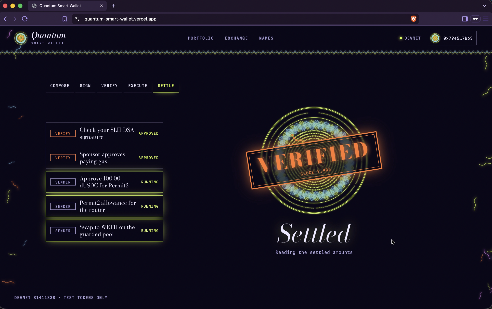

# Quantum Smart Wallet

[🚀APP](https://quantum-smart-wallet.vercel.app/)

An Ethereum Smart Wallet using hash based post-quantum signatures, onchain verification, and native account abstraction via EIP-8141 and ERC-8421.

> ⚠️ Research/educational code — not audited. Do not use it to protect real funds.
>

Imagine waking up tomorrow and discovering that the cryptography protecting your Ethereum wallet is broken. Your private key can be recovered. Your funds can be stolen. And your wallet cannot defend itself. We don't know when quantum computers will become powerful enough to make this possible. But we know the mathematics already.

A native Ethereum wallet that replaces classical transaction authorization with SLH-DSA-SHA2-128s, a post-quantum signature algorithm standardized by NIST. Using EIP-8141 and ERC-8421, we demonstrate post-quantum transactions with native validation and alternative mempool support. You can send assets, trade tokens, and register ENS names, all authorized by post-quantum signatures.

# What Was Built

- [x] [Rust post-quantum (SLH-DSA-SHA2-128s) cryptography library and CLI](rslh/)
- [x] [TypeScript bindings: Rust WASM library](slhts/)
- [x] [Solidity SLH-DSA signature verifier, native quantum smart account and factory](slhsol/)
- [x] [Quantum-gated Uniswap v4 hook](slhsol/src/QuantumGuardHook.sol)
- [x] [ENSv2 names, vaults and registrar](slhsol/ensv2/)
- [x] [Web wallet](apps/web/)
- [x] [Backend and infrastructure deployment: account creation, faucet, gas sponsorship, devnet, alternative mempool, RPC and explorer](apps/web/server/README.md)
- [x] [Cross-implementation validation: OpenSSL, rslh and slhts](eval/)

# Try our wallet

[Quantum Smart Wallet](https://quantum-smart-wallet.vercel.app/)

[Quantum Smart Wallet](https://quantum-smart-wallet.vercel.app/)

## SLH-DSA-SHA2-128s

[FIPS 205: Stateless Hash-Based Digital Signature Standard](https://nvlpubs.nist.gov/nistpubs/FIPS/NIST.FIPS.205.pdf)

NIST’s FIPS 205 defines SLH-DSA, a stateless, hash-based digital signature algorithm derived from SPHINCS+. Its SLH-DSA-SHA2-128s variant uses SHA-256 and prioritizes smaller signatures. The standard specifies key generation, signing, and verification for authenticating data with resistance to quantum computing attacks.

## EIP-8141

[EIP-8141: Frame Transaction](https://eips.ethereum.org/EIPS/eip-8141)

EIP-8141 proposes native account abstraction through transactions composed of separate validation, gas payment, and execution frames. It allows smart accounts to define custom authorization logic, including post-quantum signature verification, while supporting key rotation, batched operations, and sponsored transaction fees.

## ERC-8421

[ERC-8421: Frame Transaction Alternative Mempools](https://ethereum-magicians.org/t/erc-8421-frame-transaction-alternative-mempools/29800)

ERC-8421 proposes alternative mempool rules for EIP-8141 frame transactions. It defines a framework for transaction admission and propagation outside the default public mempool, with validation restrictions designed to resist denial-of-service attacks while accommodating more flexible smart-account validation policies.

---

## Shared devnet

The reproducible demo stack uses chain **81411338** and the pinned ethrex
`9aa3645d` frame-transaction profile.

- [Devnet and persistent node setup](infra/devnet/README.md)
- [Public RPC gateway and explorer routing](infra/gateway/README.md)

The shared deployment exposes:

| Service | URL |
| --- | --- |
| Execution RPC | https://altmempool.bailo.london/rpc |
| Alternative mempool | https://altmempool.bailo.london/mempool |
| Explorer | https://altmempool.bailo.london/explorer/ |
| Contract addresses and ABIs | https://altmempool.bailo.london/explorer/contracts |
| Mined transaction history | https://altmempool.bailo.london/explorer/chain |

See the [deployed contract addresses](slhsol/deployments/shared-devnet.json). Address pages
show live balances, bytecode and mined transactions involving each address;
contract ABIs are published from the deployment artifacts. The Pool and Activity
tabs show alternative-mempool admission separately from chain history.

## AI Disclosure

The core cryptography, signature verification, smart contracts, and account abstraction logic were designed and written by humans. AI assisted with infrastructure, DevNet deployment, alternative mempool integration, frontend development, styling, automation, and documentation. We believe security-critical code deserves human craftsmanship, while AI helps accelerate everything around it.

[Read our AI Usage Disclosure](AI.md).
